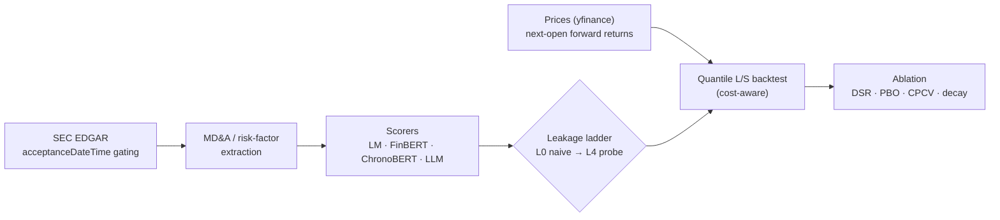

# Point-in-Time NLP/LLM Textual Alpha

[](https://github.com/kbd0011/pit-textual-alpha/actions/workflows/ci.yml)
[](LICENSE)
[](https://www.python.org/)

A point-in-time research pipeline for one question: *how much of the apparent return predictability from
reading corporate disclosures survives once each filing is dated to when the market could actually read it?*
Filings come from SEC EDGAR and are gated on `acceptanceDateTime` (rolled to the next business day when accepted
after the 17:30 ET cutoff). MD&A text is extracted and scored, and a cost-aware long/short backtest compares a
naive, period-dated signal with the dissemination-gated one.

The code is organized around two ladders. The **method ladder** has four scorers: the Loughran-McDonald
dictionary, FinBERT, ChronoBERT (a chronologically consistent encoder) and an OpenAI LLM. The
**leakage-control ladder** runs from L0 (naive dating) and L1 (timestamp gating) through L2 entity
anonymization and L3 chronologically consistent models to an L4 memorization probe. Showing that an LLM can
predict returns is not new (Lopez-Lira & Tang, 2023); the aim here is a reproducible point-in-time benchmark
that measures how much of a measured edge each leakage control removes.

## Result: FinBERT on real EDGAR filings, L0 vs L1

[`scripts/run_pipeline.py`](scripts/run_pipeline.py) runs the first two rungs end to end on public data:

- **Universe:** 10 sector-spread large caps (AAPL, MSFT, JNJ, JPM, XOM, PG, KO, INTC, WMT, CAT) and their
  10-Ks filed 2017–2023; filings with no locatable MD&A or risk-factor section are skipped.
- **Text and scoring:** MD&A (Item 7), falling back to Item 1A risk factors. FinBERT (`yiyanghkust/finbert-tone`)
  scores the first 30 sentences of each section as mean p(positive) − p(negative).
- **Signal:** each day, each name carries the score of its latest filing, treated as knowable either at the
  fiscal period end (L0, naive) or at its dissemination time (L1, gated).
- **Backtest:** tercile long/short, weekly rebalance, entry at the next session's open, 10 bps per unit of
  turnover, 5-day forward returns from yfinance adjusted opens.

| Arm | Filing treated as knowable at | Net Sharpe (full sample, ×√252) |
|-----|-------------------------------|:-------------------------------:|
| L0 naive | fiscal period end | −1.06 |
| L1 gated | dissemination time (`acceptanceDateTime`) | −0.31 |

Both Sharpe values are computed on the full 2017–2023 sample, not on cross-validation folds. Neither arm is
profitable after costs, so neither comes near the Deflated Sharpe bar of 0.95. This is a negative result and
is reported as one: on this small cross-section, annual-report tone gives no tradable edge, gated or not.


The left panel is the method × leakage heatmap (one method, two rungs in this run). The right panel is the
horizon-decay plot; it has a single point because only the 5-day horizon was run.

## Pipeline


The ablation harness ([`src/eval/ablations.py`](src/eval/ablations.py)) takes one signal panel per
(method, leakage-level) cell and returns full-sample net Sharpe (per period and ×√252), the **Deflated Sharpe
Ratio** against the expected maximum over the configurations tried, the mean and spread of out-of-sample
Sharpe across **CPCV** test folds, a single **PBO** across cells, and a decay-by-horizon curve.

## Layout
```
pit-textual-alpha/
├── IMPLEMENTATION_LOGIC.md      # research design and module map
├── DATA.md                      # free data sources and the acceptanceDateTime rule
├── LLM_PROMPTS.md
├── requirements.txt
├── configs/config.yaml
├── scripts/run_pipeline.py      # the EDGAR -> FinBERT -> L0/L1 ablation run above
├── src/
│   ├── ingest/edgar.py          # throttled EDGAR client, acceptanceDateTime + dissemination time, MD&A extraction
│   ├── ingest/prices.py         # adjusted-open forward returns with next-open entry
│   ├── ingest/universe.py       # point-in-time membership table; current-snapshot mode raises a survivorship warning
│   ├── pit/leakage.py           # point-in-time guards and look-ahead assertions
│   ├── features/sentiment.py    # Loughran-McDonald, FinBERT, ChronoBERT (vintage-selected) scorers
│   ├── llm/openai_signal.py     # cached OpenAI scorer with entity anonymization and a knowledge-cutoff guard
│   ├── backtest/portfolio.py    # quantile long/short formation and cost-aware backtest
│   └── eval/                    # L4 memorization probe, ablation sweep (DSR/PBO/CPCV), plots
├── tests/                       # per-module tests, including look-ahead tests (no network or GPU; models mocked)
└── .github/workflows/ci.yml
```

## Reproduce
```bash
make setup        # install dependencies
make check        # lint + typecheck + tests (the same steps the CI workflow runs; no network or GPU)
SEC_USER_AGENT="Your Name your@email.com" make run   # EDGAR -> FinBERT -> L0/L1 ablation and figure
```
`make run` downloads filings from EDGAR, FinBERT from Hugging Face and prices from yfinance. To list a
company's filings with acceptance and dissemination times:
`python -m src.ingest.edgar --cik 320193 --forms 10-K` (with `SEC_USER_AGENT` set).

## Design decisions
- **Point-in-time is the crux.** Gating on `acceptanceDateTime` (not `filingDate` or `periodOfReport`) is
  the decision that separates a real-time signal from look-ahead, and `tests/test_lookahead.py` checks that
  future-dated information is rejected and that after-hours filings roll to the next business day.
- **The ladder measures leakage instead of assuming it away.** Each rung is a separate signal panel run
  through the same backtest, so the gap between rungs is a measured number.
- **Costs and multiple testing are in the harness, not bolted on.** Every cell is net of turnover costs, and
  the Deflated Sharpe and PBO account for the number of configurations tried.

## Scope and limitations
- **What has run:** FinBERT at L0 and L1 on the 10-name universe above. The dictionary and LLM scorers, ChronoBERT, the L2–L4
  rungs and multi-horizon decay are implemented and unit-tested with mocked models, but not yet run on
  EDGAR data.
- **Sharpe construction:** the backtest applies each day's 5-day forward return as that day's return, so
  consecutive days overlap and the ×√252 figure is not a standard annualized Sharpe. Read the two values as a
  comparison between arms on the same footing.
- **Universe:** a fixed list of 10 current large caps, annual 10-Ks only, and FinBERT sees the first 30
  sentences of each section (a CPU budget). A fixed list of today's large caps builds in survivorship bias.
  `src/ingest/universe.py` supports a historical membership CSV for a point-in-time universe; its bundled
  S&P 1500 fetch returns current constituents only and raises a `SurvivorshipWarning`.
- **Prices:** yfinance, no CRSP. The Stooq fallback in `src/ingest/prices.py` is not split/dividend adjusted
  (the run above uses yfinance adjusted opens).
- **Next:** a point-in-time S&P 1500 universe, the remaining scorers and rungs, sector neutralization, and
  earnings-call transcripts as a second text source.

## References
- Lopez-Lira, A. & Tang, Y. (2023). *Can ChatGPT Forecast Stock Price Movements?* — arXiv:2304.07619.
- Loughran, T. & McDonald, B. (2011). *When Is a Liability Not a Liability? Textual Analysis, Dictionaries, and 10-Ks.* Journal of Finance. ([SRAF data](https://sraf.nd.edu/loughranmcdonald-master-dictionary/))
- Huang, Yang et al. *FinBERT* — `yiyanghkust/finbert-tone`, `ProsusAI/finbert` (Hugging Face).
- ChronoBERT / ChronoGPT — chronologically-consistent encoders, `manelalab/chrono-*` (Hugging Face).
- López de Prado, M. (2018). *Advances in Financial Machine Learning* (purged/combinatorial CV). Wiley.
- Bailey, D. & López de Prado, M. (2014). *The Deflated Sharpe Ratio.* J. Portfolio Management.
- SEC EDGAR — [data.sec.gov](https://www.sec.gov/os/accessing-edgar-data) (point-in-time `acceptanceDateTime`).
