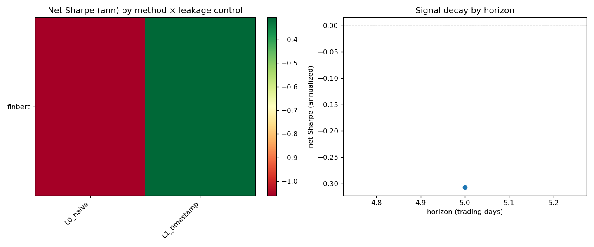
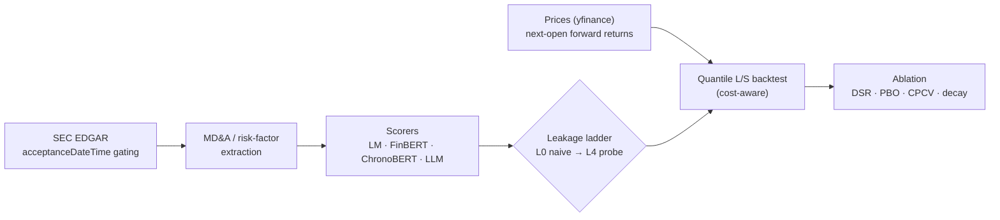

# Point-in-Time NLP/LLM Textual Alpha

[](https://github.com/kbd0011/pit-textual-alpha/actions/workflows/ci.yml)
[](LICENSE)
[](https://www.python.org/)

> **Result (real free-data demonstration — honest negative).** End-to-end on **real SEC EDGAR filings**: 29
> 10-Ks across 8 large caps, FinBERT-scored, with the daily signal formed twice — naively (period-dated, L0)
> vs. `acceptanceDateTime`-gated (L1). Neither arm is profitable (net Sharpe **−1.06 naive vs −0.31 gated**,
> Deflated Sharpe ≈ 0, **PBO 0.50**) — a candid negative consistent with a weak annual-report signal on a thin
> cross-section. **The deliverable is the rigorous point-in-time / leakage-decomposition pipeline**, not a
> tradable edge; scale to the full S&P 1500 + the LLM method ladder for a real study.
> Reproduce: `SEC_USER_AGENT="..." python scripts/run_pipeline.py`.



**Thesis.** *How much of the apparent return predictability from LLM analysis of corporate disclosures
survives a rigorous removal of look-ahead bias and memorization?*

The contribution is **not** "an LLM predicts returns" (already shown by Lopez-Lira & Tang, 2023). It is a
clean, reproducible, point-in-time-correct benchmark that **decomposes measured alpha** into (a) genuine
real-time textual signal vs. (b) leakage/memorization — across a ladder of methods (dictionary → fine-tuned
encoder → instruction-tuned LLM) and a ladder of leakage controls.

## Why this is the #1 project for you
- Sits on the hottest 2024–2026 hiring theme (LLM/NLP "textual alpha").
- Uses your strengths: ML/AI research, synthetic data, Python.
- Runs entirely on **free** data (EDGAR, FinBERT, ChronoBERT) + your OpenAI API access.
- Engages a *live, unsettled* research question, so an honest result is genuinely differentiating.

## What "done" looks like
A repo whose README states an honest headline like:
> "Real-time long/short net Sharpe 0.6 (Deflated Sharpe 0.4 over 60 trials); naive (leaky) Sharpe 1.9.
> ~70% of the naive signal is attributable to look-ahead/memorization. Signal concentrates in small-cap,
> high-uncertainty filings and decays after T+2. Costs 10 bps; universe = S&P 1500 as-of each date; no CRSP."

## Pipeline


## Layout
```
project4_textual_alpha/
├── IMPLEMENTATION_LOGIC.md   # read this first
├── DATA.md                   # free data sources + the acceptanceDateTime rule
├── LLM_PROMPTS.md            # ordered prompts to build each component
├── requirements.txt
├── configs/config.yaml
├── src/
│   ├── ingest/edgar.py       # IMPLEMENTED: acceptanceDateTime-gated EDGAR client + MD&A extraction
│   ├── ingest/prices.py      # IMPLEMENTED: adjusted-open forward returns, next-open entry (no look-ahead)
│   ├── ingest/universe.py    # IMPLEMENTED: point-in-time membership w/ explicit survivorship handling
│   ├── pit/leakage.py        # IMPLEMENTED: point-in-time guards + leakage assertions
│   ├── features/sentiment.py # IMPLEMENTED: LM dict, FinBERT, ChronoBERT (vintage) scorers
│   ├── llm/openai_signal.py  # IMPLEMENTED: cached OpenAI scorer w/ anonymization + cutoff guard
│   ├── backtest/portfolio.py # IMPLEMENTED: quantile L/S formation + cost-aware backtest
│   └── eval/                 # IMPLEMENTED: memorization probe (L4), ablation sweep (DSR/PBO/CPCV), plots
├── tests/                    # IMPLEMENTED: leakage + per-module tests (no network/GPU; models mocked)
└── .github/workflows/ci.yml
```

## Run (once built)
```bash
pip install -r requirements.txt
export SEC_USER_AGENT="Your Name your@email.com"   # required by SEC
export OPENAI_API_KEY=...                           # for the generative-LLM signal
python -m src.ingest.edgar --cik 0000320193 --forms 10-K   # example: Apple 10-Ks
```

## Data caveats (disclosed, not hidden)
- **Survivorship bias.** `src/ingest/universe.py` separates two regimes. A *PIT-accurate* `UniverseTable`
  (built from a historical membership CSV with `start_date`/`end_date` per name) gives true point-in-time
  constituents. The bundled `fetch_current_sp1500()` returns **today's** constituents only — its
  `members_as_of(date)` is identical for every date and raises a `SurvivorshipWarning`. Backtests run on a
  current snapshot are upward-biased; supply a historical CSV for an honest universe, or report results as
  survivorship-uncorrected.
- **No CRSP.** Prices come from yfinance (Stooq fallback); the Stooq fallback is **not** split/dividend
  adjusted. Forward returns enter at the next session's open (`src/ingest/prices.py`) to avoid look-ahead.

## Reproduce the experiment
```bash
# 1. Ingest filings (PIT-gated) and prices, score with each method, form the signal panels.
# 2. Run the ablation sweep -> results table + figure:
python -c "from src.eval.ablations import run_ablation, decay_by_horizon, plot_ablation; ..."
```
The ablation harness (`src/eval/ablations.py`) takes one signal panel per (method, leakage-level) cell and
emits net Sharpe (per-period + annualized), the **Deflated Sharpe Ratio** against the expected maximum over
every configuration tried, **CPCV** out-of-sample Sharpe mean/std, a single **PBO** across cells, and a
decay-by-horizon curve, saving a two-panel figure to `reports/`.

## Results

> **Template — fill from your real run; do not inflate.** Numbers below are placeholders, not measured results.

Headline (per `shared/RIGOR.md`):

> "Real-time long/short **net Sharpe [X.XX]** (Deflated Sharpe [Y.YY] over [N] trials); naive (leaky)
> Sharpe [Z.ZZ]. About **[P]% of the naive signal is attributable to look-ahead / memorization** (the
> L0→L1→L2→L3 gap and the L4 probe). Signal concentrates in [regime] and decays to ~0 after [T+k]. Costs
> assumed [10] bps; universe = S&P 1500 as-of each date ([survivorship-corrected? yes/no]); no CRSP. PBO [bb]."

| method ↓ / leakage → | L0 naive | L1 timestamp | L2 anon | L3 chrono | L4 probe-adj |
|----------------------|:--------:|:------------:|:-------:|:---------:|:------------:|
| Loughran-McDonald    |   —      |     —        |   —     |    —      |     —        |
| FinBERT              |   —      |     —        |   —     |    —      |     —        |
| OpenAI LLM           |   —      |     —        |   —     |    —      |     —        |

**The contribution is the decomposition, not a big Sharpe.** If the leakage-controlled (L1–L3) and
memorization-adjusted (L4) signal is weak or zero, that *is* the finding: most apparent LLM "textual alpha"
on disclosures is look-ahead / memorization rather than real-time reading. Report the controlled number
honestly, alongside the naive one, with DSR and PBO.

## Reproduce
```bash
make setup        # install dependencies
make check        # lint + typecheck + test (CI parity; no network/GPU)
SEC_USER_AGENT="Your Name your@email.com" make run   # real EDGAR -> FinBERT -> ablation
```
Seeds are fixed and the run is `acceptanceDateTime`-gated, so results reproduce.

## Design decisions, limitations & what's next
- **Point-in-time is the crux.** Gating on `acceptanceDateTime` (not `filingDate` / `periodOfReport`) is the
  one decision separating a real signal from look-ahead; the L0→L4 ladder *measures* that gap instead of
  assuming it away.
- **Honest negative.** The shipped run is a small free-data demonstration (29 filings, 8 names), so the signal
  is unprofitable — and that is reported, not hidden. The deliverable is the rigorous PIT pipeline.
- **What I'd do next:** scale to the full S&P 1500 via a PIT membership table; add the ChronoBERT (L3) and
  LLM memorization-probe (L4) rungs; sector-neutralize; add earnings-call transcripts as a second text source.

## References
- Lopez-Lira, A. & Tang, Y. (2023). *Can ChatGPT Forecast Stock Price Movements?* — arXiv:2304.07619.
- Loughran, T. & McDonald, B. (2011). *When Is a Liability Not a Liability? Textual Analysis, Dictionaries, and 10-Ks.* Journal of Finance. ([SRAF data](https://sraf.nd.edu/loughranmcdonald-master-dictionary/))
- Huang, Yang et al. *FinBERT* — `yiyanghkust/finbert-tone`, `ProsusAI/finbert` (Hugging Face).
- ChronoBERT / ChronoGPT — chronologically-consistent encoders, `manelalab/chrono-*` (Hugging Face).
- López de Prado, M. (2018). *Advances in Financial Machine Learning* (purged/combinatorial CV). Wiley.
- Bailey, D. & López de Prado, M. (2014). *The Deflated Sharpe Ratio.* J. Portfolio Management.
- SEC EDGAR — [data.sec.gov](https://www.sec.gov/os/accessing-edgar-data) (point-in-time `acceptanceDateTime`).
